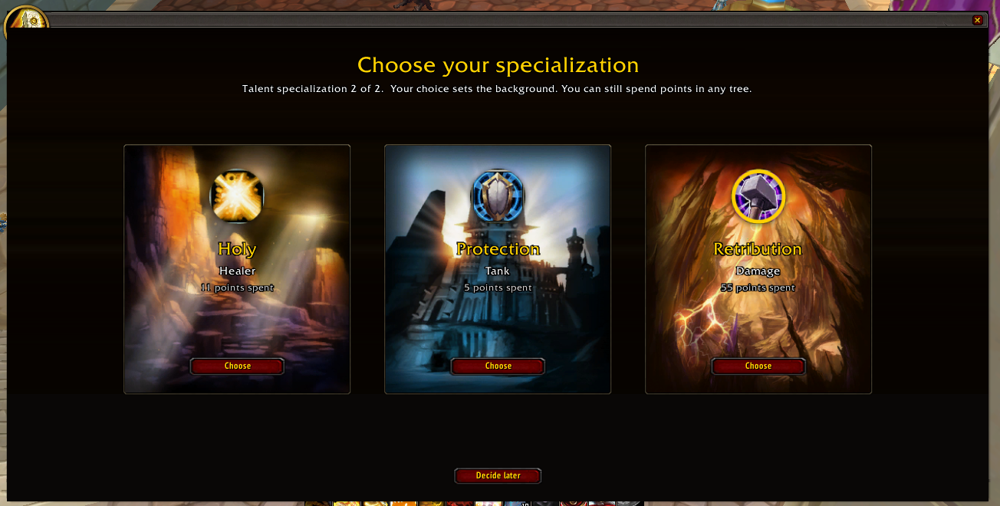
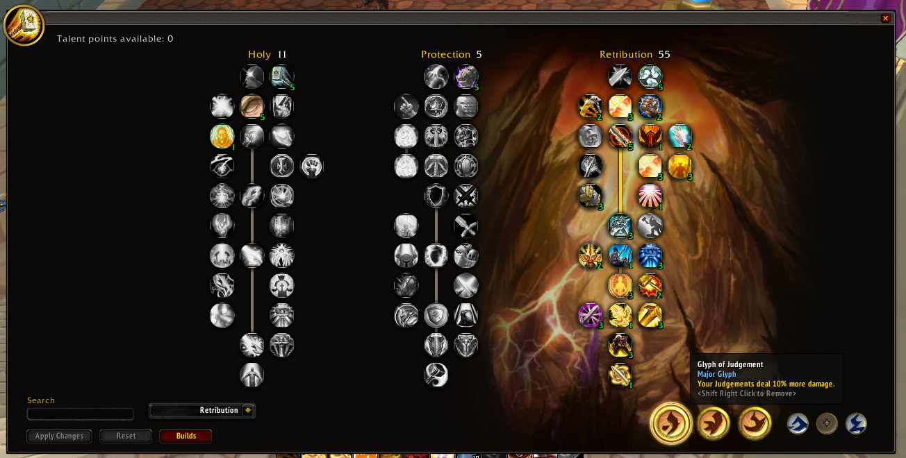
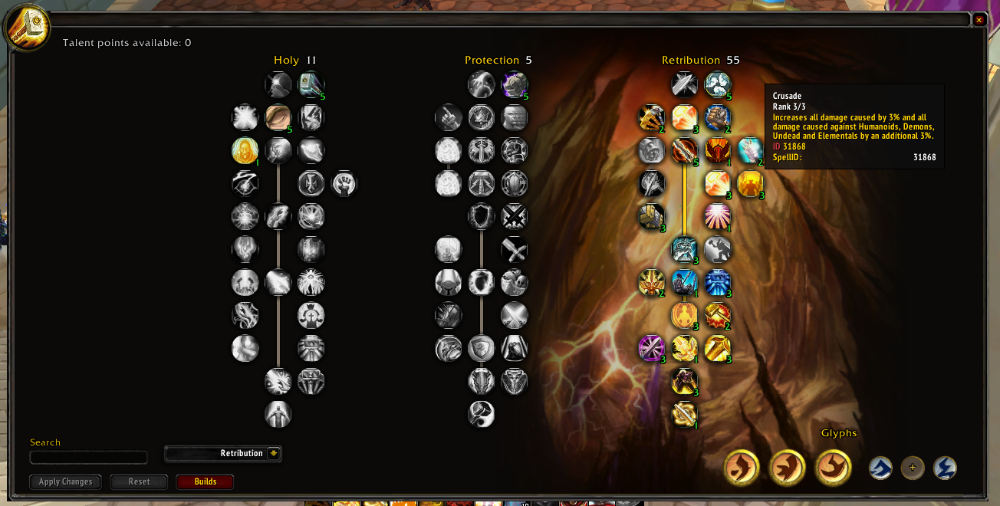
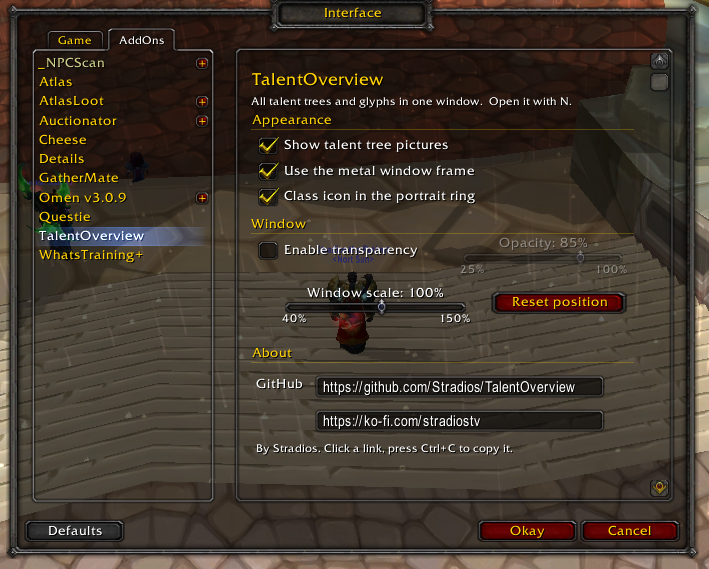

# TalentOverview

**Classic frame (default)**

**Metal frame (optional)**

**Settings**

A World of Warcraft 3.3.5 addon that replaces the default talent window with one wide window.

- All three talent trees side by side, with the active specialization's own background picture
- Glyph sockets with the game's own glyph graphics
- Search box, Apply / Reset, a build list and a specialization chooser
- Classic game frame by default, optional metal frame, ElvUI skin detected automatically
- Settings under Game Menu > Interface > AddOns > TalentOverview (or `/to config`)

## Install

Copy the `TalentOverview` folder to `World of Warcraft\Interface\AddOns\`. Press `N` in game.

## Support

If you like the addon: https://ko-fi.com/stradiostv

Author: Stradios
